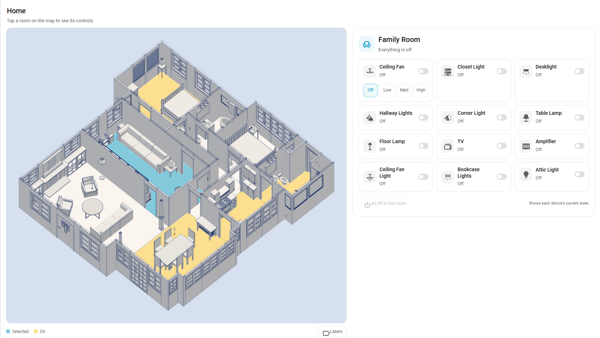

# Floor3DX Card

A Home Assistant dashboard card that shows a live 3D model of your home and binds its objects to your entities: lights that follow the bulb's colour and brightness, doors and shades that move with their covers, fans that spin at their speed, pictures and video on screens, and the time of day on a roofless plan. Floor3DX is a fork of [floor3dpro-card](https://github.com/levonisyas/floor3dpro-card) and [floor3d-card](https://github.com/adizanni/floor3d-card); an existing configuration for either works as it is.

 


**What this fork adds**

- **Compressed models.** Draco, Meshopt, KTX2 and WebP glTF files load with decoders kept next to the card, so a house that was 30 MB is 4 MB and works offline. Compression scripts included.
- **A visual editor** on Home Assistant's own form components: sections, sortable lists, every object of the model in the menus, pick an object with a tap in the preview. Adapted from [giosci1994/floor3d-card](https://github.com/giosci1994/floor3d-card).
- **Lights that behave like the real ones.** Brightness and colour from the entity (`follow_entity`), a wall switch for the state and the bulb behind it for the colour (`color_entity`), one light for a multi-part fixture (`light_object`), a light placed in front of its object so a slatted headboard throws its pattern on the wall (`offset`). A `color: entity` condition tints the lamp shade in the light's colour.
- **Pictures and video on any surface** (`type3d: image`): camera snapshots, album art, animated GIFs decoded in the card, a looping video while a switch is on and a dark still while it is off. Works on surfaces the model exported without texture coordinates.
- **Shades that shrink with their position** (`type3d: shade`), with a second motor for top-down/bottom-up shades.
- **Time of day without a roof** (`daylight`): ambient and colour from the sun's elevation and a weather entity, beams through the windows that follow the sun round the house, glass that glows after dark, a slider to scrub through the day.
- **The NeonPlan 3D / NextFloor look** (`look`): neon, blueprint and day themes on your own model, with glowing edge lines and lit lamps that shine.
- **Transparent walls** (`transparent`): any walls see-through by a fixed amount, or by an amount a switch or slider sets, down to not drawn at all.
- **Fixes.** Doors and windows no longer displace on a return visit; Draco models render in a stable order; `rotate.axis: y` works unquoted; a scene with more shadow-casting lights than the GPU can take no longer goes black; entity colour tracking no longer re-renders on every state change.

Everything is off unless configured, so a config written for the parent cards renders exactly as it did. The options are documented below, with a changelog in [CHANGELOG.md](CHANGELOG.md).

## Lineage and compatibility

| Project | Author | Role |
|---|---|---|
| [floor3d-card](https://github.com/adizanni/floor3d-card) | Andrea Di Zanni | The original card: model loading, entity bindings, the configuration format |
| [floor3dpro-card](https://github.com/levonisyas/floor3dpro-card) | Levent Erdem | Rebuilt the engine around on-demand rendering, a shared model cache, and a mobile profile. It describes itself as backwards compatible with floor3d-card configurations |
| floor3dx-card (this repository) | FortranFour | The changes listed below, on top of floor3dpro-card 1.5.3-Pro.Faz.2.1 |

Floor3DX changes nothing in the configuration format. A floor3dpro-card or floor3d-card configuration works as it is; only the first line differs:

```yaml
type: custom:floor3dx-card
```

The card registers its own element names (`floor3dx-*`), so it can be installed next to floor3dpro-card and floor3d-card and used on the same dashboard. That makes it easy to compare them on a duplicate of an existing card before switching.

For the full configuration reference, see the [floor3dpro-card README](docs/floor3dpro-card-README.md) (kept here unmodified) and the [floor3d-card documentation](https://github.com/adizanni/floor3d-card#readme).

## What this fork changes

### Compressed models

`objfile` accepts `.glb` and `.gltf` files that use any of these glTF extensions. The card reads the file header and sets up only the decoders the model declares, so plain models load exactly as before.

| Extension | What it compresses | Decoder |
|---|---|---|
| `KHR_draco_mesh_compression` | geometry | `draco_*` files next to the card, in a worker pool |
| `EXT_meshopt_compression`, `KHR_mesh_quantization` | geometry | bundled in the card |
| `EXT_texture_webp` | texture download size | the browser |
| `KHR_texture_basisu` (KTX2) | texture download size and GPU memory | `basis_*` files next to the card, in a worker pool |

Upstream loads compressed files with a bare `GLTFLoader`, which stalls at "Loading: 100%".

Compressed models can run more fluidly on low-powered devices, such as phones.


### Full-resolution rendering

- **The canvas follows its container in every view type.** Upstream watches the card's size only in panel and sidebar views. Elsewhere the drawing buffer keeps the size it had when the model finished loading. A card that finished while hidden, or before the layout settled, kept a small default buffer that the browser stretched across the card, which looks like a low-resolution render.
- **`pro_skill: mobile` no longer pins the pixel ratio to 1.** It drops to 1 only while the camera is being dragged and redraws at device resolution about 160 ms after the drag ends. Animations do not trigger the drop. `pixel_ratio: 1` restores the permanent clamp.
- **Antialiasing under the mobile profile** is skipped only on screens with a device pixel ratio of 2 or more, where it is not visible.
- **Anisotropic filtering** (8x by default) keeps floor and wall textures sharp at shallow angles.
- The card redraws when the device pixel ratio changes (browser zoom, moving the window to another monitor).

### Fix: doors and windows displaced after returning to a view

The card caches the loaded model and builds a new card from the cache each time a view is opened. The cache shares geometry between those cards, but the setup for `door`, `rotate`, `cover` and `room` entries re-centres geometry in place. The first visit looked right; from the second visit on, every door and window part started from already-shifted geometry and was shifted again, so it ended up far from the house until the browser was refreshed.

Those meshes now take a private copy of their geometry. The re-centring step also checks that the mesh occupies the same place afterwards as before, puts it back if not, and logs one console line. `dev/harness/test_lifecycle.py` is the regression test.

### Smaller fixes

- A second card that reused a cached GLB skipped the GLB-specific handling because the model type was only set on a cold load.
- Upstream logged `Entity <undefined> not found` for every entity-less `gesture` entry on every state update, hundreds of lines per update on a large configuration. Gesture entries are now silent, and a genuinely missing entity warns once.
- Load errors are shown in the card. Progress no longer prints `Infinity%` when the server compresses the response.
- The console banner includes a build id, so it is obvious which file a browser is running.

### New option: one light for a multi-part fixture

A `type3d: light` entry creates one light per object in its `object_id` group. Every light costs GPU time on every frame, lit or not. `light_object` keeps the whole group clickable but creates a single light on the named object, which can be a member of the group or any other object in the model.

```yaml
- entity: switch.closet
  type3d: light
  object_id: <closet_strips>            # every strip toggles the switch when clicked
  light:
    light_object: Fluorescent_strip_2   # only this object emits light
    lumens: '900'
```

### Light colour and brightness from the entity

A virtual light takes its brightness and colour from the Home Assistant entity while the entity is on. A dimmer scales the intensity between 0 and `lumens`; a colour or tunable-white light also sets the light's colour. A switch or a plain on/off light reports neither, so it uses `lumens` and `color` from the configuration. `follow_entity` chooses what is taken from the entity:

```yaml
- entity: light.dining_chandelier
  type3d: light
  object_id: <chandelier>
  light:
    light_object: '158_3'
    lumens: '3000'
    color: '#FFB830'
    follow_entity: brightness     # dim with the dimmer, keep the warm colour
```

| `follow_entity` | brightness | colour |
|---|---|---|
| `yes` (default) | from the entity | from the entity |
| `brightness` | from the entity | `light.color` |
| `color` | `light.lumens` | from the entity |
| `no` | `light.lumens` | `light.color` |

Upstream intended `yes` but the code compared colour arrays by reference and assigned where it meant to compare, so a light with a `color_mode` attribute was re-lit and the whole scene re-rendered on every state change anywhere in Home Assistant. That is fixed.


### The NeonPlan / NextFloor look (`look`)

[NeonPlan 3D](https://github.com/Mastershort/neonplan3d) and [NextFloor](https://github.com/therealMRBK/NextFloor) draw their own geometry, so their style is baked in: a dark stage, flat muted surfaces in a few blues, glowing edge lines along every wall, and "signal" colours (a lit lamp, an open window) kept saturated against the muted base. `look` reproduces that on the model this card has loaded, without touching the model file. Off by default: without a `look` block the card renders exactly as before.

```yaml
look:
  theme: neon            # neon | blueprint | day | off
  accent: '#37e0ff'      # edge colour of the neon theme
  edges: 'yes'           # outline lines along mesh edges
  edge_angle: 60         # draw an edge where faces meet at more than this; 40 is denser, 60 thins window mullions
  edge_opacity: 0.85
  glow: 0.9              # a lit lamp object glows in its light colour (0 to 2)
  flat: 'yes'            # flat shading, no specular
  keep_signal: 'yes'     # bright saturated colours stay as they are
  stage: 'yes'           # background from the theme; with daylight, night to day
  walls: wall            # object name prefixes that get the wall tint
  floors: room, floor
```


Every mesh keeps its original material; a themed copy maps the colour to the theme per pixel in a small shader patch (adapted from NextFloor's `viewer/theme.ts`, MIT), so textures still show through as pattern and switching themes is a uniform change. Edges are `EdgesGeometry` line segments drawn additively, normal blending in the day theme where additive glow would vanish. Colour conditions, lights, images, shades and daylight all work on top: a `Gold` colour condition stays gold because it is a signal colour, `LightSteelBlue` goes to the muted base, and a `type3d: light` entry's objects take an emissive glow in the light's colour while it is on, which is what makes lamps visible on surfaces this dark. With `daylight`, the stage background runs from the theme's night colour to its day colour.

What is not taken from those projects, because it depends on their generated geometry: fold-away walls, the painted room-light surface, the plan editor and furniture library.

### Transparent walls (`transparent`)

Walls, or any objects, drawn see-through by a fixed amount or by an amount an entity sets. Nothing changes without the option. Transparency runs from 0 (solid, as the model came) to 100 (invisible), the same scale as `room.transparency`.

A card-level list, for walls that should always be see-through:

```yaml
transparent:
  - objects: 'wall_*'          # object ids, * patterns, <group> for an object group, or a list of them
    transparency: 60
  - objects: ['wall_12', 'wall_13']
    transparency: 100           # these two are not drawn at all
```

An entity row, for walls that follow a switch or a slider:

```yaml
entities:
  - entity: input_boolean.xray          # on: 80, off: solid
    type3d: transparent
    object_id: 'wall_*'
    transparent:
      transparency: 80
      transparency_off: 0               # default 0
      state: 'on'                       # default: on, open, home, playing... count as on
  - entity: input_number.wall_see_through   # 0..100 slider sets the transparency itself
    type3d: transparent
    object_id: '<outer_walls>'
    transparent:
      invert: 'no'                      # yes: 100 - value, for a slider that means opacity
```


A numeric entity state is the transparency itself: 0 to 100, or 0 to 1 when the entity's `max` is 1 or below. Each mesh keeps its material and only its opacity is lowered; a material shared with an object outside the rules is cloned first so that object stays solid. At 100 the mesh is hidden, so it stops casting shadows as well; back at 0 the material is restored exactly. Works on top of `look` (the themed material is the one faded; the edge lines stay, which gives an x-ray outline) and of colour conditions on other objects.

When several rules name the same object, the later rule in the configuration wins: an "all walls" rule first and "this room's walls" rules after it let a selector pick a room while a slider sets the amount (template sensors give each rule its value; see the forum thread for a package).

### Shadow budget

Every shadow-casting light needs a shadow map, and each shadow map takes a texture unit in the shader. A GPU exposes a fixed number of them to one material (16 on phones and integrated graphics, 32 on many discrete cards); a scene that asks for more fails to compile its shaders and draws nothing, a black card with no error. The card now counts: with `shadow: 'yes'`, the first N lights whose entry does not say `shadow: 'no'` get a shadow, where N is what the GPU has left after its own textures, and the rest still shine without one. A console warning names the lights that lost their shadow. With `extralightmode: 'yes'` the lights that are on come first, so a light gets its shadow when it is switched on if there is room. `shadow_budget` overrides N for a GPU that still goes black at the computed value.

To stay within the budget by design: `shadow: 'no'` on lights whose shadow nobody would notice, and `light_object` to make one light per fixture instead of one per bulb. Ported from giosci1994/floor3d-card.

### A switch for the state, a bulb for the colour

A colour bulb behind a wall switch has its colour on one entity and its power on another, and the bulb goes `unavailable` whenever the switch is off. `color_entity` on an entry, for `type3d: light` and `type3d: color`, names the entity that supplies brightness and colour while `entity` keeps supplying the state. When the colour entity is unavailable or reports no colour, the entry uses its configured `color` and `lumens`; changes to the colour entity alone re-light and re-colour the object.

```yaml
- entity: switch.kitchen_sink
  color_entity: light.kitchen_sink_bulb
  type3d: light
  object_id: sink_light
  light:
    lumens: '900'
    color: '#FFB830'
- entity: switch.kitchen_sink
  color_entity: light.kitchen_sink_bulb
  type3d: color
  object_id: sink_light
  colorcondition:
    - state: 'off'
      color: LightSteelBlue
    - state: 'on'
      color: entity
```

### Time of day on a roofless plan (`daylight`)

`sky: 'yes'` puts a real sun in the scene, which needs a roof to stop it. `daylight` is for a plan you look into from above: it reads the sun's elevation and azimuth from `sun.sun` and a condition from any weather entity, and turns them into a light level and colour (cool by day, orange at the horizon, dim blue at night), a hemisphere light with sky and ground colours, a background colour, a sun spot outside each listed window that only shines when the sun is on that side of the house, a separate ambient for exterior objects that goes nearly dark at night, and a glow on glass when the room light is on after dark. Everything is a card-level option; the interior light entries need no change.

```yaml
daylight:
  weather_entity: weather.home        # any weather integration; the state is the condition
  time_entity: input_number.preview_hour   # optional: 0-24 replaces the real sun, for tuning
  ambient:
    day: 0.8                          # default: globalLightPower
    night: 0.15                       # default: a fifth of day
  colors: { day: '#e9f0ff', dusk: '#ff9a4a', dawn: '#ff8a4a', night: '#8a9bc4', ground: '#7a7068' }
  sun_colors: { day: '#fff3dc', dusk: '#ff8a3a', dawn: '#ffb070' }   # beams only; omit to follow colors
  gradient: { night: -8, dusk: 0, day: 15 }   # elevation stops: fully night at or below -8, the horizon colour at 0, fully day from 15
  background: { day: '#9fc5e8', dusk: '#f2a45c', night: '#1c2438' }   # or 'no'
  hemisphere: 'yes'
  weather: { cloudy: 0.6, rainy: 0.45 }   # condition -> daylight factor; merged over defaults
  windows:
    - object_id: <living_room_glass>  # pane object or group; the thin axis is the window's normal
      lumens: 3000
      angle: 35
      shadow: 'no'
  exterior: [<driveway>, <garden>, <outer_walls>]
  exterior_night: 0.08
  exterior_sun: 0.6                 # directional sun on the exterior objects only; the facade facing the sun brightens as a whole
  glow:
    - object_id: <living_room_glass>
      entity: light.living_room
      color: '#ffd27a'
```

`colors` tints the room light (ambient, hemisphere and camera light); `sun_colors`, when given, tints only the window beams, so the house can stay neutral grey while the sun goes orange. The light colour and the background run along a gradient by sun elevation: the night colour at or below the `night` stop, the dusk (or dawn, when the sun is rising) colour at the `dusk` stop, the day colour at or above the `day` stop, blended smoothly in between, so the low sun is fully orange and both sides of it fade out of it gradually. `north` (the card's existing option) tells the card which way the model faces, so the window spots follow the real sun. `time_entity` accepts a number of hours 0 to 24, a time (an `input_datetime` such as `06:40:00`; 6:00 sunrise, 12:00 noon, 18:00 sunset) or any entity with `elevation` and `azimuth` attributes. `beam_full` is the elevation at which the window beams reach full strength (default 4°). Exterior objects are moved to their own render layer: only the exterior ambient and `exterior_sun`, a directional light that follows the real sun, reach them, and the window spots never touch them; they remain clickable. Each window spot sits just inside its pane and is aimed along the sun's actual direction to where that line meets the floor, so its pool lands near the sill under a high sun, reaches deep into the room under a low one, and swings sideways between morning and afternoon. YAML only for now; no editor section.


### Shades that shrink with their position (`type3d: shade`)

`type3d: cover` slides an object out of the way; a roller or cellular shade should shrink instead. `type3d: shade` scales the fabric object in height from its bottom edge: `entity` is the motor that raises the bottom edge (Home Assistant's `current_position`, 100 = fully raised), and `shade.top_entity`, optional, is a second motor that lowers the top edge, for top-down/bottom-up shades. Changes animate over 1.5 s. `shade.invert: yes` for a cover that reports 100 as closed. Point the entry at the fabric only; headrail and window stay where they are.

```yaml
- entity: cover.bedroom_shade_bottom
  type3d: shade
  object_id: shade_fabric
  shade:
    top_entity: cover.bedroom_shade_top
```


### Mesh colour from the light itself

A `type3d: color` condition can take its colour from the entity instead of a fixed value: `color: entity` uses the light's current colour darkened by its brightness (a dim bulb is a dark bulb), `color: entity_color` uses the colour at full strength. The mesh is re-coloured whenever the light's colour or brightness changes, not only when it switches on or off. Colour comes from `rgb_color`, or from the colour temperature when that is all the light reports, or white.

```yaml
- entity: light.headboard_strip
  type3d: color
  object_id: <headboard>
  colorcondition:
    - state: 'off'
      color: LightSteelBlue
    - state: 'on'
      color: entity
```

### Shadows cast by the light's own object

A light sits at the centre of its object, so an object that should be lit from in front (a slatted headboard, a railing, a sculpture) needs the light moved out: `light.offset` shifts it by a fixed amount in model units. With `shadow: 'yes'` on the card and on the entry, the object then throws its shadow on the wall behind it; `shadow_map_size: 2048` keeps thin shadows crisp, and `angle` (the cone's half-angle in degrees, default 18) sets how much of the wall is lit. Use `light_object` to name one part of a group as the source, because the source itself never casts a shadow.

```yaml
- entity: light.headboard_strip
  type3d: light
  object_id: <headboard>
  light:
    light_object: top_rail
    shadow: 'yes'
    shadow_map_size: '2048'
    angle: '60'
    offset: { x: -70, 'y': -20, z: 0 }     # out in front of the headboard
    light_direction: { x: 5, 'y': 0, z: 0 } # pointing back at the wall
```

### Pictures on model objects (`type3d: image`)

`type3d: text` paints a state onto an object. `type3d: image` paints a picture onto it: a still image, an animated GIF, or a video file. The picture comes from the entity's `entity_picture` attribute by default (a camera snapshot, a person's photo, a media player's album art), from any other attribute, from the state, or from a URL that can include the state.

```yaml
- entity: camera.driveway            # camera snapshot on a picture frame, refreshed every 10 s
  type3d: image
  object_id: Frame7_1
  image:
    refresh: 10

- entity: media_player.family_room   # album art on the TV screen
  type3d: image
  object_id: '1_21'
  image:
    fit: contain
    background: '#000000'

- entity: switch.arcade              # a looping video while on, a dark still while off
  type3d: image
  object_id: arcade_screen
  image:
    url:
      'on': /local/arcade/attract.mp4
      'off': /local/arcade/screen-off.jpg
    fit: contain
    background: '#000000'

- entity: weather.home               # an animated GIF chosen by the state
  type3d: image
  object_id: Frame3_1
  image:
    url: /local/weather/{state}.gif
```

| `image.` | Values | Default |
|---|---|---|
| `source` | `entity_picture`, `attribute`, `state`, `url` | `entity_picture`, or `url`/`attribute` when one of those is set |
| `attribute` | attribute name, for `source: attribute` | |
| `url` | a URL; `{state}` and `{attr:name}` are replaced from the entity. Or a map of state to URL, with an optional `default` | |
| `refresh` | seconds between re-fetches of an unchanged URL | 0, never |
| `fit` | `contain`, `cover`, `stretch` | `contain` |
| `background` | CSS colour behind a letterboxed picture | transparent |
| `aspect` | object width divided by height | measured from the object |
| `rotate` | 0, 90, 180, 270 | 0 |
| `max_size` | longest side of the texture, in pixels | 1024 |
| `mirror` | `yes` flips the picture left-to-right | no |
| `planar_uv` | `yes` replaces the object's own UV mapping with a flat projection | only when the object has none |

Objects exported without texture coordinates (Sweet Home 3D panels, plain boxes: an arcade marquee, a TV screen, a sign) get a flat mapping generated by the card, oriented so the picture reads correctly from the side the face points at. `rotate` and `mirror` adjust it if the model's face points the other way; `planar_uv: yes` forces the flat mapping on an object whose own UVs tile or are otherwise unsuitable.

Animated GIFs are decoded in the card, so they animate in every browser and keep the scene's animation loop running while they show. Video files (`.mp4`, `.webm`) play muted in a loop. The card re-draws the object when the URL changes, when `refresh` fires, and on every animation frame while a GIF or video is showing. `/api/` URLs without an access token are fetched with the dashboard's credentials, so `entity_picture` of a camera works as is. An entity is required; use any entity, `sun.sun` for example, for a fixed picture.


## Visual editor

The card editor is built on Home Assistant's own form components (`ha-form`, entity pickers, toggles, sortable lists), adapted from [giosci1994/floor3d-card](https://github.com/giosci1994/floor3d-card) (MIT) to the options of this card:

- Settings in sections: 3D model, camera and navigation, light and shadows (with the `daylight` block), interaction, rendering.
- Lists of entities, object groups and views, dragged to reorder, each opening its own page with only the options of its type. An entity line warns when the entity does not exist or its object is not in the model.
- Object menus list the groups and every object of the model, with a search; the **pick** button turns the preview into a picker, a tap on an object fills the field (for a group, taps add and remove objects). The objects of the item being edited are outlined in the preview.
- **Use the current view** copies the preview camera into the initial view.
- Object ids may contain `*`: `Lamp_*` stands for every object whose name matches, in entities and groups alike.
- The editor writes a short form: no switches at their default, numbers unquoted, group objects as plain ids. The card accepts `true`/`false` as well as `'yes'`/`'no'`, and plain ids in groups.

On a Home Assistant without `ha-form` the previous editor is shown instead. `daylight.windows`, `exterior` and `glow` lists, and `image.url` as a state map, are edited in YAML.


## Options added by this fork

| Option | Values | Default |
|---|---|---|
| `draco_path` | folder holding the Draco decoder files | found automatically |
| `basis_path` | folder holding the Basis transcoder files | found automatically |
| `pixel_ratio` | `device`, `adaptive`, or a number | `device`; `adaptive` under `pro_skill: mobile` |
| `antialias` | `yes`, `no` | `yes`; see the mobile profile above |
| `anisotropy` | 1 to 16 | 8 |
| `light.light_object` | an object name | not set: one light per object in the group |
| `light.follow_entity` | `yes`, `brightness`, `color`, `no` | `yes` |
| `light.offset` | `{x, y, z}` in model units, added to the object's centre | 0 |
| `light.shadow_map_size` | 128 to 4096 | 512 |
| `daylight` | see above | off |
| `type3d: shade` | `shade.top_entity`, `shade.invert` | |
| `look` | see above | off |
| `transparent` | card-level list of `{objects, transparency}` rules; see above | off |
| `type3d: transparent` | `transparent.transparency`, `transparent.transparency_off`, `transparent.state`, `transparent.invert` | |
| `shadow_budget` | number of shadow-casting lights | from the GPU's texture units |
| `color_entity` | an entity id, on `light` and `color` entries | `entity` |
| `colorcondition[].color` | `entity`, `entity_color` in addition to any colour | |
| `type3d: image` | see above | |

## Companion card: Floor3D Snapshot Card

[Floor3D Snapshot Card](https://github.com/FortranFour/floor3d-snapshot-card) turns the model behind a Floor3DX card (or a floor3d-card or floor3dpro-card) into a fast, tappable floor plan for wall tablets, phones and guests. Its visual editor finds the floor3d cards in your dashboards, renders the model once in your browser to a static orthographic picture, detects the rooms and places the card's entities in the room each one stands in. Tablets and phones then load a small module and a few images, and no 3D runs on them. Tap a room's floor to get its controls; a guest mode limits locks, garage doors, alarms and volume.

It shares this card's conventions: the Neon, Blueprint and Day themes of `look`, an optional sunlight layer that follows the real sun from Home Assistant's location, and a live 3D preview to turn, tilt and roll the model before the snapshot is taken. When it imports a Floor3DX card, it copies `look.theme` and `north`. Install it from HACS as a custom repository of type Dashboard.



## Digital Twin Ecosystem

Floor3DX Card is one component of a Home Assistant digital twin ecosystem, combining learned household routines, weekly schedule planning, and 3D previews with real device control and energy management: https://github.com/FortranFour/home-scheduler.


## Installation

### HACS

1. HACS → three-dot menu → **Custom repositories**.
2. Add `https://github.com/FortranFour/floor3dx-card` with type **Dashboard**.
3. Install **Floor3DX Card** and reload the browser.

HACS adds the resource `/hacsfiles/floor3dx-card/floor3dx-card.js` and downloads the decoder files into the same folder.

### Manual

1. Download every file from the [latest release](https://github.com/FortranFour/floor3dx-card/releases/latest) into `/config/www/floor3dx/`.
2. Settings → Dashboards → three-dot menu → Resources → add `/local/floor3dx/floor3dx-card.js?v=1` as a JavaScript module.
3. Change the number after `?v=` every time you replace the file. Browsers keep the old copy otherwise.

Install the card one way only. Two resources that both define `floor3dx-card` conflict.

### Decoder files

The card looks for the Draco and Basis decoders in this order: the `draco_path` or `basis_path` option, the card's own folder, a `draco/` or `basis/` sub-folder of it, then jsDelivr. With the files from a release in place, nothing is fetched from the internet. With `pro_log: engine`, the console reports which source was used.

## Compressing a model

The card binds entities to object names, and its door code assumes every node has an identity transform. General-purpose optimisers break both: `gltf-transform optimize` and `gltfpack` without `-kn` merge and rename objects, and position quantisation moves a transform onto every node. The scripts in `tools/` avoid this:

```bash
cd tools
npm install
node compress.mjs          /path/to/home.glb home     # writes home.draco.glb and home.meshopt.glb
node compress-textures.mjs /path/to/home.glb home     # writes home.draco-webp.glb
```

`compress.mjs` keeps node and mesh names in order and leaves every node transform untouched. Its Meshopt output keeps positions at full precision for that reason, which is why Draco comes out smaller here. `compress-textures.mjs` converts PNG textures to lossless WebP and JPEG textures to WebP at quality 90, and scales anything larger than 2048 pixels (pass another limit as a third argument).

Measured on two Sweet Home 3D exports, loaded through the card:

| Model | Original | Draco | Meshopt | Draco + WebP |
|---|---|---|---|---|
| 2,944 meshes, 0.2 MB of textures | 12.8 MB | 4.0 MB | 6.7 MB | not needed |
| 1,345 meshes, 2.8 MB of textures | 15.5 MB | 5.9 MB | 8.3 MB | 3.3 MB |

Draco adds roughly half a second of decoding on first load; the decoded model is cached for the rest of the browser session. Draco geometry stayed within 0.02 model units of the original, and Meshopt geometry was exact.

WebP textures need a current browser. Safari before version 14 shows them blank.

## Troubleshooting

- **The card still behaves like an older version.** Check the build id in the console banner. If it has not changed, the browser is running a cached file: change the `?v=` number on the resource (manual installs) and reload with the cache cleared.
- **`light_object <name> not found in the model`.** The name in `light.light_object` does not match any object.
- **`object <name> moved by (...) during door/pivot setup and was put back`.** The safety check described above caught a displaced part and corrected it. Please open an issue with the line.

## Development

```bash
npm ci
npm run build        # lint, bundle to dist/floor3dx-card.js, copy the decoders into dist/
npm start            # watch mode, served on port 5000
```

The source stays close to upstream so that upstream changes remain easy to merge. The element names and the build id are applied at build time by `rollup-fork-identity.js`; source files still say `floor3dpro-*`.

`dev/harness/` runs the built card in headless Chromium against `demo/demo.glb`. See its README.

Pushing a tag such as `v1.0.1` builds the card and publishes a release with the card and decoder files attached.

## Credits

Floor3DX exists because of the work of Andrea Di Zanni on [floor3d-card](https://github.com/adizanni/floor3d-card) and Levent Erdem on [floor3dpro-card](https://github.com/levonisyas/floor3dpro-card). The engine changes are kept as a single commit on top of upstream so that they can be proposed back to floor3dpro-card. The card is built on [three.js](https://threejs.org/); the Draco and Basis decoders shipped in `dist/` come from the three.js distribution and are covered by their own licenses (Apache 2.0).

## License

MIT. See [LICENSE](LICENSE), which keeps the copyright notices of both upstream projects.
