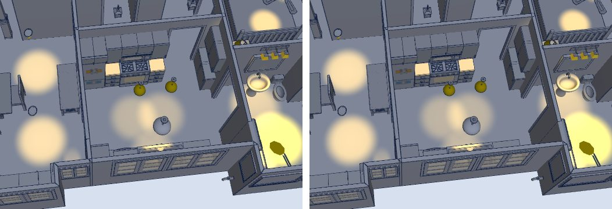
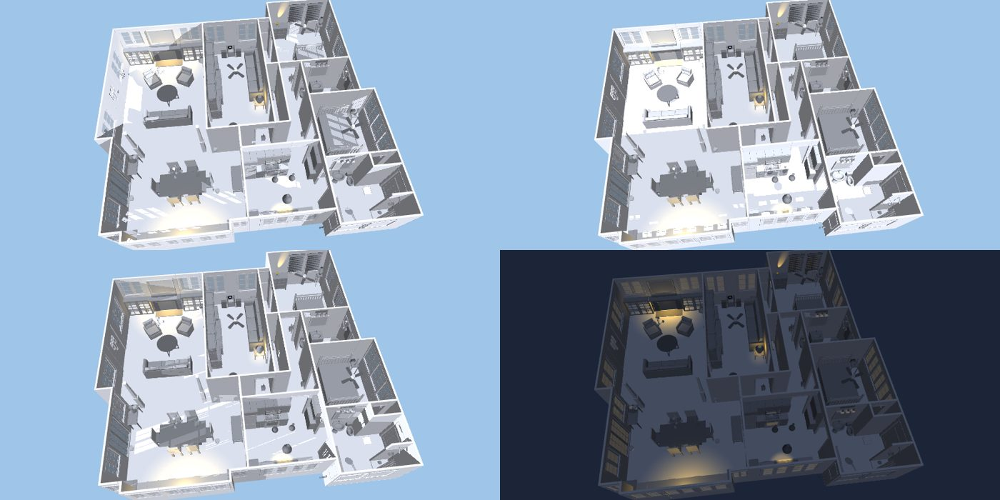
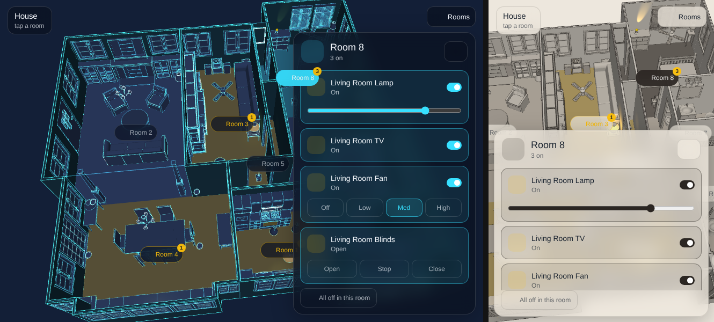
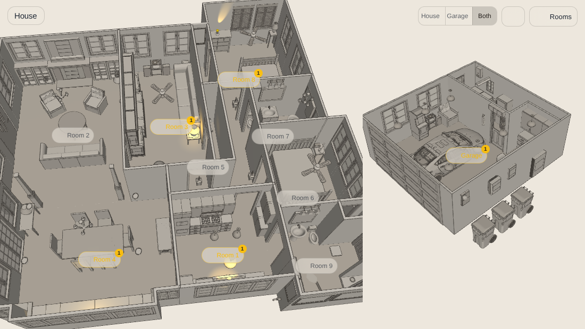
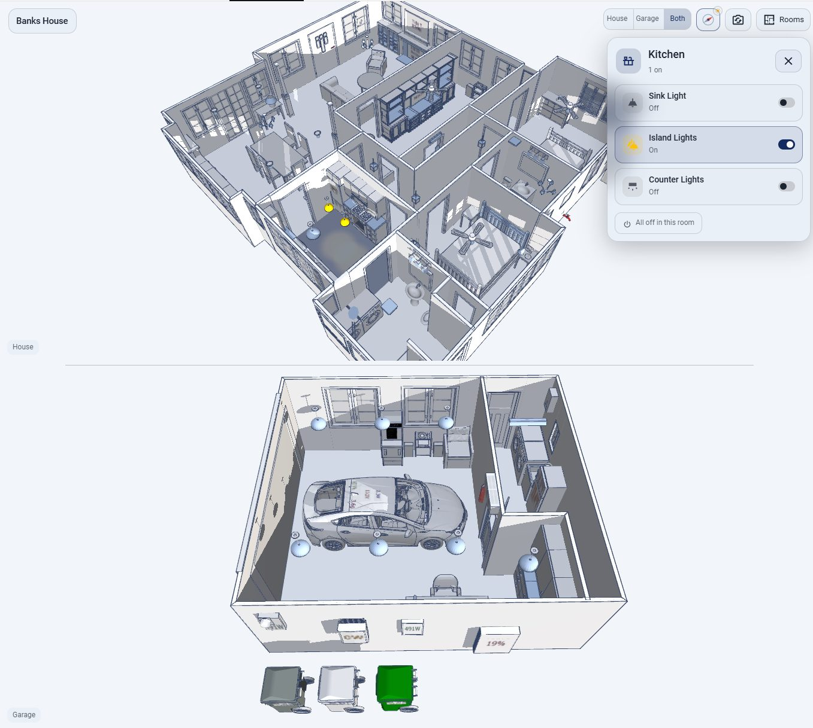

# Floor3DX Card

A Home Assistant dashboard card that shows a live 3D model of your home and binds its objects to your entities: lights that follow the bulb's colour and brightness, doors and shades that move with their covers, fans that spin at their speed, pictures and video on screens, and the time of day on a roofless plan. Floor3DX is a fork of [floor3dpro-card](https://github.com/levonisyas/floor3dpro-card) and [floor3d-card](https://github.com/adizanni/floor3d-card); an existing configuration for either works as it is.

 


**What this fork adds**

- **Compressed models.** Draco, Meshopt, KTX2 and WebP glTF files load with decoders kept next to the card, so a house that was 30 MB is 4 MB and works offline. Compression scripts included.
- **A visual editor** on Home Assistant's own form components: sections, sortable lists, every object of the model in the menus, pick an object with a tap in the preview. Adapted from [giosci1994/floor3d-card](https://github.com/giosci1994/floor3d-card).
- **Lights that behave like the real ones.** Brightness and colour from the entity (`follow_entity`), a wall switch for the state and the bulb behind it for the colour (`color_entity`), one light for a multi-part fixture (`light_object`), a light placed in front of its object so a slatted headboard throws its pattern on the wall (`offset`). A `color: entity` condition tints the lamp shade in the light's colour.
- **Pictures and video on any surface** (`type3d: image`): camera snapshots, album art, animated GIFs decoded in the card, a looping video while a switch is on and a dark still while it is off. Works on surfaces the model exported without texture coordinates.
- **Shades that shrink with their position** (`type3d: shade`), with a second motor for top-down/bottom-up shades.
- **Time of day without a roof** (`daylight`): ambient and colour from the sun's elevation and a weather entity, beams through the windows that follow the sun round the house, glass that glows after dark, a slider to scrub through the day.
- **The NeonPlan 3D / NextFloor look** (`look`): neon, blueprint, day, paper, ember and pastel themes, or your own colours, on your own model, with glowing edge lines, lit lamps that shine, and outlines that skip wall seams and room borders.
- **Transparent walls** (`transparent`): any walls see-through by a fixed amount, or by an amount a switch or slider sets, down to not drawn at all.
- **Fixes.** Doors and windows no longer displace on a return visit; Draco models render in a stable order; `rotate.axis: y` works unquoted; a scene with more shadow-casting lights than the GPU can take no longer goes black; entity colour tracking no longer re-renders on every state change.

Everything is off unless configured, so a config written for the parent cards renders exactly as it did. The options are documented below, with a changelog in [CHANGELOG.md](CHANGELOG.md).

## Lineage and compatibility

| Project | Author | Role |
|---|---|---|
| [floor3d-card](https://github.com/adizanni/floor3d-card) | Andrea Di Zanni | The original card: model loading, entity bindings, the configuration format |
| [floor3dpro-card](https://github.com/levonisyas/floor3dpro-card) | Levent Erdem | Rebuilt the engine around on-demand rendering, a shared model cache, and a mobile profile. It describes itself as backwards compatible with floor3d-card configurations |
| floor3dx-card (this repository) | FortranFour | The changes listed below, on top of floor3dpro-card 1.5.3-Pro.Faz.2.1 |

Floor3DX changes nothing in the configuration format. A floor3dpro-card or floor3d-card configuration works as it is; only the first line differs:

```yaml
type: custom:floor3dx-card
```

The card registers its own element names (`floor3dx-*`), so it can be installed next to floor3dpro-card and floor3d-card and used on the same dashboard. That makes it easy to compare them on a duplicate of an existing card before switching.

For the full configuration reference, see the [floor3dpro-card README](docs/floor3dpro-card-README.md) (kept here unmodified) and the [floor3d-card documentation](https://github.com/adizanni/floor3d-card#readme).

## Version 2.0: current three.js, same picture

2.0 moves the card from three.js r130 (2021) to r186, Lit 3 and TypeScript 5, built with esbuild. Nothing in the configuration changes, and an existing dashboard renders the same: the reference views of two real models (plain, lamps with shadows, daylight, two `look` themes) differ from 1.9.12 by 0.00% of pixels. Two things that three.js changed on the way are kept at their old behaviour by default, with the new behaviour as an option:

| Option | `legacy` (default: the 1.x picture) | the new value |
|---|---|---|
| `lights` | A lamp's reach is its `distance` and its brightness falls off linearly to it, raised to `decay`; `lumens` means what it meant in 1.x | `physical`: three.js' inverse-square falloff (`1/d^decay`, `distance` a soft cutoff) for the lamps. Each lamp's intensity is set so that it is as bright as in legacy halfway along its reach (2.3): brighter next to the bulb, fainter at the edge; the camera light, ambient and daylight are unchanged. No re-tuning needed; the picture differs only in the lamps' pools |
| `color_management` | Hex colours are taken as given and the output is not sRGB-encoded | `managed`: colours are sRGB and the output is sRGB-encoded, so textures come out as authored. Since 2.3 the light amounts are raised to 1.8 in the shader and the `look` palette and stage colours are converted to linear, so the rest of the picture stays close to legacy (measured on the reference views: the garage within 2 levels, the house's shading a little flatter). Textures (pictures, webp) are the one thing that looks different, on purpose |

`exposure` sets the tone-mapping exposure (default 0.6 in both colour modes). Both settings are page wide in three.js, so all floor3dx cards on one dashboard view should use the same values. The three fields are in the editor's Light and shadows section.

What else the upgrade brings: three.js' current GLTF loader (KHR material extensions, meshopt), KTX2 and Draco decoders, and a bundle that builds in under a second. The last 1.x release, 1.9.12, stays available; a `1.x` branch can receive fixes if a model turns out to need the old engine.

## Version 2.2: sturdier, lighter, two small extras

- **One bad entry no longer blanks the card.** An entity whose object is not in the model (or whose template fails) used to stop the whole setup, and every readout after it stayed empty with an error in the card. It is now left out with a console warning naming it, and the others work.
- **No more texture leak.** Every state change of a text panel left the previous texture on the GPU; on a dashboard that stays open, a readout updating every few seconds leaked a texture each time. Fixed, and guarded by a test.
- **Cheaper state changes.** The objects of a changed entity are found through an index instead of a walk over the whole model (two to three thousand objects) per bound object.
- **Shadows at most every 300 ms while something moves.** A fan turning with shadows on re-rendered every shadow map every frame; now a few times a second, and exactly once when the movement stops.
- **Fans that speed up and slow down** (`rotate.ramp: 2`, seconds to full speed and back; default: at once, as before).
- **A loading screen**: the model's name and the step (downloading, materials, geometry, preparing the scene), a bar in the theme's colours, the percentage and the megabytes.

Checked by the pixel comparison (unchanged picture), by Node unit tests (`npm test`) and by two tests on a fake WebGL context that count draw calls and textures without a GPU (`dev/harness/test_budget.py`, `test_leaks.py`).

## Version 2.1: merged static geometry (`merge_static`)

A Sweet Home 3D export is one mesh per wall, panel, chair leg or picture frame — a house is two to three thousand of them — and the card issued one draw call for each, every frame. Only the objects a configuration refers to need to stay separate. With `merge_static: yes` the rest is merged when the model loads, per level, material and shadow setting, and the look's edge lines of those meshes with them:

```yaml
merge_static: yes
```

Measured on a real house (2,944 meshes, 5 lamps with shadows, 806×1322): 3,054 draw calls → 401, and the CPU work of a frame from 26 ms to 8 ms; with a `look` theme 5,313 → 426 and 47 ms → 5 ms. The reference views are pixel-identical to the unmerged ones.

What stays separate: every object named anywhere in the configuration (entities, `object_groups`, `hide_objects`, `transparent`, `look.keep`, `edge_skip`, `daylight` windows — `*` patterns and `<groups>` expanded), hidden objects, translucent materials (three.js sorts those per object), multi-material meshes. Merging runs last, after `wall_seal`, the look, `hide_spare_panels` and the entity setup, so all of those see the model as it was. In the editor's preview nothing is merged, since the object menus need every name. A merged wall or chair no longer answers to a tap (it did nothing before either), and the merged copies take about as much memory again as the model. Off by default; it is in the editor's 3D model section.

## What this fork changes

### Compressed models

`objfile` accepts `.glb` and `.gltf` files that use any of these glTF extensions. The card reads the file header and sets up only the decoders the model declares, so plain models load exactly as before.

| Extension | What it compresses | Decoder |
|---|---|---|
| `KHR_draco_mesh_compression` | geometry | `draco_*` files next to the card, in a worker pool |
| `EXT_meshopt_compression`, `KHR_mesh_quantization` | geometry | bundled in the card |
| `EXT_texture_webp` | texture download size | the browser |
| `KHR_texture_basisu` (KTX2) | texture download size and GPU memory | `basis_*` files next to the card, in a worker pool |

Upstream loads compressed files with a bare `GLTFLoader`, which stalls at "Loading: 100%".

Compressed models can run more fluidly on low-powered devices, such as phones.


### Full-resolution rendering

- **The canvas follows its container in every view type.** Upstream watches the card's size only in panel and sidebar views. Elsewhere the drawing buffer keeps the size it had when the model finished loading. A card that finished while hidden, or before the layout settled, kept a small default buffer that the browser stretched across the card, which looks like a low-resolution render.
- **`pro_skill: mobile` no longer pins the pixel ratio to 1.** It drops to 1 only while the camera is being dragged and redraws at device resolution about 160 ms after the drag ends. Animations do not trigger the drop. `pixel_ratio: 1` restores the permanent clamp.
- **Antialiasing under the mobile profile** is skipped only on screens with a device pixel ratio of 2 or more, where it is not visible.
- **Anisotropic filtering** (8x by default) keeps floor and wall textures sharp at shallow angles.
- The card redraws when the device pixel ratio changes (browser zoom, moving the window to another monitor).

### Fix: doors and windows displaced after returning to a view

The card caches the loaded model and builds a new card from the cache each time a view is opened. The cache shares geometry between those cards, but the setup for `door`, `rotate`, `cover` and `room` entries re-centres geometry in place. The first visit looked right; from the second visit on, every door and window part started from already-shifted geometry and was shifted again, so it ended up far from the house until the browser was refreshed.

Those meshes now take a private copy of their geometry. The re-centring step also checks that the mesh occupies the same place afterwards as before, puts it back if not, and logs one console line. `dev/harness/test_lifecycle.py` is the regression test.

### Smaller fixes

- A second card that reused a cached GLB skipped the GLB-specific handling because the model type was only set on a cold load.
- Upstream logged `Entity <undefined> not found` for every entity-less `gesture` entry on every state update, hundreds of lines per update on a large configuration. Gesture entries are now silent, and a genuinely missing entity warns once.
- Load errors are shown in the card. Progress no longer prints `Infinity%` when the server compresses the response.
- The console banner includes a build id, so it is obvious which file a browser is running.

### New option: one light for a multi-part fixture

A `type3d: light` entry creates one light per object in its `object_id` group. Every light costs GPU time on every frame, lit or not. `light_object` keeps the whole group clickable but creates a single light on the named object, which can be a member of the group or any other object in the model.

```yaml
- entity: switch.closet
  type3d: light
  object_id: <closet_strips>            # every strip toggles the switch when clicked
  light:
    light_object: Fluorescent_strip_2   # only this object emits light
    lumens: '900'
```

### Light colour and brightness from the entity

A virtual light takes its brightness and colour from the Home Assistant entity while the entity is on. A dimmer scales the intensity between 0 and `lumens`; a colour or tunable-white light also sets the light's colour. A switch or a plain on/off light reports neither, so it uses `lumens` and `color` from the configuration. `follow_entity` chooses what is taken from the entity:

```yaml
- entity: light.dining_chandelier
  type3d: light
  object_id: <chandelier>
  light:
    light_object: '158_3'
    lumens: '3000'
    color: '#FFB830'
    follow_entity: brightness     # dim with the dimmer, keep the warm colour
```

| `follow_entity` | brightness | colour |
|---|---|---|
| `yes` (default) | from the entity | from the entity |
| `brightness` | from the entity | `light.color` |
| `color` | `light.lumens` | from the entity |
| `no` | `light.lumens` | `light.color` |

Upstream intended `yes` but the code compared colour arrays by reference and assigned where it meant to compare, so a light with a `color_mode` attribute was re-lit and the whole scene re-rendered on every state change anywhere in Home Assistant. That is fixed.

<p> </p>

### The NeonPlan / NextFloor look (`look`)

[NeonPlan 3D](https://github.com/Mastershort/neonplan3d) and [NextFloor](https://github.com/therealMRBK/NextFloor) draw their own geometry, so their style is baked in: a dark stage, flat muted surfaces in a few blues, glowing edge lines along every wall, and "signal" colours (a lit lamp, an open window) kept saturated against the muted base. `look` reproduces that on the model this card has loaded, without touching the model file. Off by default: without a `look` block the card renders exactly as before.

```yaml
look:
  theme: neon            # neon | blueprint | day | paper | ember | pastel | custom | off, or a palette name (below)
  accent: '#37e0ff'      # edge colour of the neon theme
  edges: 'yes'           # outline lines along mesh edges
  edge_angle: 60         # draw an edge where faces meet at more than this; 40 is denser, 60 thins window mullions
  edge_opacity: 0.85
  glow: 0.9              # a lit lamp object glows in its light colour (0 to 2)
  flat: 'yes'            # flat shading, no specular
  keep_signal: 'yes'     # bright saturated colours stay as they are
  stage: 'yes'           # background from the theme; with daylight, night to day
  walls: wall            # object name prefixes that get the wall tint
  floors: room, floor
  edge_skip: images, texts, seams, floors   # see below; default: nothing skipped
  keep: meter_glass, <photos>              # objects the theme leaves exactly as the model has them
```

`keep` names objects (ids, `*` patterns, `<group>`s) that the theme does not touch at all: their own material and shading stay and they get no edge lines, so a frosted glass dome, a photograph or a screen keeps its look inside a themed house.

**Which edges are drawn.** A line is drawn where two faces meet at more than `edge_angle`, and along the open edge of a surface. On an exported model some of those open edges are not outlines you want: the joint where one straight wall was exported as two segments, the border between two rooms' floors where there is no wall, the edges of a picture or screen. `edge_skip` names what gets no line, in a list or a comma-separated string:

| Entry | Effect |
|---|---|
| `seams` | the joint between two coplanar wall segments is not drawn (a corner between walls still is) |
| `floors` | the joint between two coplanar floor objects is not drawn (the floor edge along a wall still is) |
| `ceilings` | no lines on the ceiling objects (`room_N_2` in a Sweet Home 3D export; the floor prefixes with `_2`). A ceiling faces down and is invisible from above, but its outline is still an edge, which shows as a line across every room opening that has no wall (2.4.4) |
| `coplanar` | both of the above, for every pair of objects whatever their names |
| `images` | no lines on the objects of `type3d: image` rows |
| `texts` | no lines on the objects of `type3d: text` rows |
| anything else | an object id, a `*` pattern or a `<group>`: no lines on those objects (`Tide*`, `<frames>`) |

Walls and floors are told apart by the `walls` and `floors` prefixes. The joints are found geometrically. Edges are first cut where other vertices lie on them, because one edge can be a joint on part of its length and an outline on the rest (the end of a full-height wall piece beside a window: buried under the sill, exposed up the jamb, buried again above the lintel). Each part is then judged on its own: a face pressed against a face of another piece is not a visible face there, and a surface that continues on the far side (the next wall segment, the next room's floor, to 2.5 cm on a 20 m house, enough for two rooms whose borders overlap or stop short of each other by a few millimetres) means no outline. A face that meets the edge at an angle does not count, so corners, jambs, sills and object contours keep their line. The test covers the object's own pieces as well as the other objects, since Sweet Home 3D exports a wall with windows as overlapping pieces inside one mesh.

The bottom and top faces of a wall lie in the plane of the floor and the ceiling, and a Sweet Home 3D wall keeps its full footprint under a doorway, so with two different tints the floor and the wall's underside would fight for the same pixels and show a broken line across every opening. The themed material of a flat wall face lowers it by a hair (a ten-thousandth of the model), so the floor or ceiling always wins; the mesh itself and its edge lines are not moved.

A changed `look` takes effect when the card is rebuilt (the editor's reload, or a saved dashboard); the edge lines are rebuilt with it.
<p> </p>


Three more themes, not from those projects: **paper**, an architect's drawing on cream card with ink lines, walls a shade warmer and floors parchment; **ember**, charcoal surfaces with a warm cast and amber lines that glow, for a dark dashboard that is not blue; **pastel**, the model's own colours lightened and softened on a pale stage, for a house whose textures and furniture colours should still read.


**Named palettes** (2.4). Thirty-three more themes, each a palette of the custom theme, by name: `midnight-teal`, `ultraviolet`, `copper-slate`, `rose-gold`, `moss`, `sunset`, `noir`, `crt`, `ocean`, `architect`, `mint-cream`, `arctic` (one hue with a contrasting line); `infrared`, `riso` (duotone: dark surfaces one hue, bright another); `navy-tangerine`, `cyberpunk` (muted surfaces, complementary lines); `sodium`, `gold-leaf` (metals); `x-ray`, `hologram` (inverted: dark objects glow / flat surfaces, lines carry the detail); `ivory-on-black`, `ice` (a pale model on a black stage); `ink-on-paper` (a dark model on cream); `true-colour` (grey with `hue: 0.6`, the model's own colours showing through); and nine three-tone palettes with walls, floors and furniture each in their own hue (2.4.1): `harbour`, `autumn`, `coral-reef`, `berry`, `forest-floor`, `steel-brass`, `mondrian`, `lagoon-sand`, `candy`; and `dashboard` (2.5): Home Assistant's stock light dashboard — the page grey as the stage, white walls, the pale blue of its summary capsules on the floors, slate lines, and in the rooms card the icon blue as the accent and capsule-blue panels. `look: {theme: riso}` is `theme: custom` with that palette's colours; a `custom:` block beside it overrides single colours (`custom: {edges: '#ffffff'}`), and the editor shows the palette's colours in its pickers. They were chosen on a real house with its lamps on; `dev/harness/render_themes.py` renders a model under any set of palettes for comparison.


**Your own colours** (`theme: custom`). The same colour function with colours you choose, as `#rrggbb`; the editor shows them as colour pickers once Custom is selected:


```yaml
look:
  theme: custom
  custom:
    dark: '#1c2230'        # surfaces where the model is dark
    light: '#6c7a96'       # where it is bright
    walls: '#7a8aa6'       # bright colour of walls (default: light)
    floors: '#56637a'      # bright colour of floors (default: light)
    edges: '#e8f0ff'       # edge lines
    stage: '#10141c'       # background; by day with daylight: stage_day (default: stage)
    hue: 0.15              # 0..1, how much of the model's own hue remains
```

Lines blend additively on a dark background and normally on a light one, judged from `stage`. Signal colours are kept as in every theme.

Every mesh keeps its original material; a themed copy maps the colour to the theme per pixel in a small shader patch (adapted from NextFloor's `viewer/theme.ts`, MIT), so textures still show through as pattern and switching themes is a uniform change. Edges are `EdgesGeometry` line segments drawn additively, normal blending in the day theme where additive glow would vanish. Colour conditions, lights, images, shades and daylight all work on top: a `Gold` colour condition stays gold because it is a signal colour, `LightSteelBlue` goes to the muted base, and a `type3d: light` entry's objects take an emissive glow in the light's colour while it is on, which is what makes lamps visible on surfaces this dark. With `daylight`, the stage background runs from the theme's night colour to its day colour.

What is not taken from those projects, because it depends on their generated geometry: fold-away walls, the painted room-light surface, the plan editor and furniture library.

### Transparent walls (`transparent`)

Walls, or any objects, drawn see-through by a fixed amount or by an amount an entity sets. Nothing changes without the option. Transparency runs from 0 (solid, as the model came) to 100 (invisible), the same scale as `room.transparency`.

A card-level list, for walls that should always be see-through:

```yaml
transparent:
  - objects: 'wall_*'          # object ids, * patterns, <group> for an object group, or a list of them
    transparency: 60
  - objects: ['wall_12', 'wall_13']
    transparency: 100           # these two are not drawn at all
```

An entity row, for walls that follow a switch or a slider:

```yaml
entities:
  - entity: input_boolean.xray          # on: 80, off: solid
    type3d: transparent
    object_id: 'wall_*'
    transparent:
      transparency: 80
      transparency_off: 0               # default 0
      state: 'on'                       # default: on, open, home, playing... count as on
  - entity: input_number.wall_see_through   # 0..100 slider sets the transparency itself
    type3d: transparent
    object_id: '<outer_walls>'
    transparent:
      invert: 'no'                      # yes: 100 - value, for a slider that means opacity
```
<p>  </p>

A numeric entity state is the transparency itself: 0 to 100, or 0 to 1 when the entity's `max` is 1 or below. Each mesh keeps its material and only its opacity is lowered; a material shared with an object outside the rules is cloned first so that object stays solid. At 100 the mesh is hidden, so it stops casting shadows as well; back at 0 the material is restored exactly. Works on top of `look` (the themed material is the one faded; the edge lines stay, which gives an x-ray outline) and of colour conditions on other objects.

When several rules name the same object, the later rule in the configuration wins: an "all walls" rule first and "this room's walls" rules after it let a selector pick a room while a slider sets the amount (template sensors give each rule its value; see the forum thread for a package).

### Sealed wall joints (`wall_seal`)

Walls drawn by hand rarely meet to the millimetre, and a lamp inside a room throws a streak of light through the hairline gap between two segments onto whatever is behind it. `wall_seal` stretches every wall by that much at each end, in model units (centimetres for a Sweet Home 3D export; `0.5` closes a gap of up to a centimetre), when the model loads:

```yaml
wall_seal: 0.5
```

A wall is its `wall_<id>_<n>` meshes together (the `walls` prefix of `look` applies when set); the stretch is about the wall's centre and along its length only, so the thickness, the height, and the door and window frames set into the wall are as they were, and the wall's edge lines and shadows follow the stretched geometry. Each stretched wall gets its own copy of its geometry, so a box shared between walls in the file, or a model shared between cards on a page, is not stretched twice. Off without the option: the geometry is exactly the file's.

### Lamps stay in their room (`light_rooms`)

A point or spot light in three.js shines through walls: nothing occludes it unless it casts a shadow, so a lamp against a wall lights the floor of the room behind it, and a lamp in the kitchen lights the hall. Shadow maps fix that one lamp at a time, each costing a texture unit (16 or 32 for the whole material, see the budget below) and six scene passes. `light_rooms: 'yes'` confines every lamp to its room instead, for free:

```yaml
light_rooms: 'yes'
```

When the model loads, the floors (`room_N_1` of a Sweet Home 3D export) are drawn once from above into a small room map; floors that touch (an alcove, a bay window, a threshold drawn as its own floor) count as one room. While shading, each lamp's light is kept only where the surface lies in the same room as the lamp, or on no room at all (a wall face, a threshold, the ground just outside) within 25 cm of the lamp's room, so the walls of the room are still lit from inside. A lamp in no room, outside or on a floor that is not a room, shines as before. Lamps with shadows keep them. The trade: light no longer spills through an open doorway into the next room. `light_rooms: {margin: 40, floors: 'floor_*', join: 'no'}` changes the margin (model units), the floor names (`*` wildcard) and the joining. In the editor's Light and shadows section. Off by default.



### Shadow budget

Every shadow-casting light needs a shadow map, and each shadow map takes a texture unit in the shader. A GPU exposes a fixed number of them to one material (16 on phones and integrated graphics, 32 on many discrete cards); a scene that asks for more fails to compile its shaders and draws nothing, a black card with no error. The card now counts: with `shadow: 'yes'`, the first N lights whose entry does not say `shadow: 'no'` get a shadow, where N is what the GPU has left after its own textures, and the rest still shine without one. A console warning names the lights that lost their shadow. With `extralightmode: 'yes'` the lights that are on come first, so a light gets its shadow when it is switched on if there is room. `shadow_budget` overrides N for a GPU that still goes black at the computed value.

To stay within the budget by design: `shadow: 'no'` on lights whose shadow nobody would notice, and `light_object` to make one light per fixture instead of one per bulb. Ported from giosci1994/floor3d-card.

### A switch for the state, a bulb for the colour

A colour bulb behind a wall switch has its colour on one entity and its power on another, and the bulb goes `unavailable` whenever the switch is off. `color_entity` on an entry, for `type3d: light` and `type3d: color`, names the entity that supplies brightness and colour while `entity` keeps supplying the state. When the colour entity is unavailable or reports no colour, the entry uses its configured `color` and `lumens`; changes to the colour entity alone re-light and re-colour the object.

```yaml
- entity: switch.kitchen_sink
  color_entity: light.kitchen_sink_bulb
  type3d: light
  object_id: sink_light
  light:
    lumens: '900'
    color: '#FFB830'
- entity: switch.kitchen_sink
  color_entity: light.kitchen_sink_bulb
  type3d: color
  object_id: sink_light
  colorcondition:
    - state: 'off'
      color: LightSteelBlue
    - state: 'on'
      color: entity
```

### Time of day on a roofless plan (`daylight`)

`sky: 'yes'` puts a real sun in the scene, which needs a roof to stop it. `daylight` is for a plan you look into from above: it reads the sun's elevation and azimuth from `sun.sun` and a condition from any weather entity, and turns them into a light level and colour (cool by day, orange at the horizon, dim blue at night), a hemisphere light with sky and ground colours, a background colour, a sun spot outside each listed window that only shines when the sun is on that side of the house, a separate ambient for exterior objects that goes nearly dark at night, and a glow on glass when the room light is on after dark. Everything is a card-level option; the interior light entries need no change.

```yaml
daylight:
  weather_entity: weather.home        # any weather integration; the state is the condition
  time_entity: input_number.preview_hour   # optional: 0-24 replaces the real sun, for tuning
  ambient:
    day: 0.8                          # default: globalLightPower
    night: 0.15                       # default: a fifth of day
  colors: { day: '#e9f0ff', dusk: '#ff9a4a', dawn: '#ff8a4a', night: '#8a9bc4', ground: '#7a7068' }
  sun_colors: { day: '#fff3dc', dusk: '#ff8a3a', dawn: '#ffb070' }   # beams only; omit to follow colors
  gradient: { night: -8, dusk: 0, day: 15 }   # elevation stops: fully night at or below -8, the horizon colour at 0, fully day from 15
  background: { day: '#9fc5e8', dusk: '#f2a45c', night: '#1c2438' }   # or 'no'
  hemisphere: 'yes'
  weather: { cloudy: 0.6, rainy: 0.45 }   # condition -> daylight factor; merged over defaults
  windows:
    - object_id: <living_room_glass>  # pane object or group; the thin axis is the window's normal
      lumens: 3000
      angle: 35
      shadow: 'no'
  exterior: [<driveway>, <garden>, <outer_walls>]
  exterior_night: 0.08
  exterior_sun: 0.6                 # directional sun on the exterior objects only; the facade facing the sun brightens as a whole
  glow:
    - object_id: <living_room_glass>
      entity: light.living_room
      color: '#ffd27a'
```

**A real sun** (2.6): `sun: 'yes'` adds one directional light with a shadow map over the whole model, so the light comes in only through the openings — glass casts no shadow — and the ceilings of a Sweet Home 3D export (`room_N_2`, invisible from above but still there) stand in for the roof. Walls, window frames and furniture cast shadows that move across the floors through the day; the pools of sun travel from the east windows in the morning to the west ones in the evening. It needs no `shadow: yes` and no list of windows: shadows are switched on for the card and every caster shadows from both sides. `sun_strength` (default 1.4, a multiple of the day ambient), `sun_shadow_size` (2048; 4096 for a sharper pool on a large house), `sun_full` (the elevation at which the sun reaches full strength, 8°). The exterior objects get the same sun. `glow: auto` makes every translucent pane glow warm after dark (`glow_color`, `glow_intensity` 0.35, `glow_entity` to tie it to a switch), instead of listing panes with their room's entity. `time: 7.5` (or `'18:30'`) fixes the hour for a preview without an entity. With a `weather_entity`, the weather is in the light too (`weather_effects`, default on with the sun): clouds take the direct sun before the diffuse light (overcast at 0.6 leaves 0.36 of the sun and 0.8 of the daylight), rain and fog cool the tint, snow keeps the day bright; without the sun the older behaviour, the daylight scaled by the condition's factor, stays. `north` matters: with the plan drawn north-up in the view, `north` is the scene direction that points to the top of the picture.

```yaml
north: { x: -1, z: 0 }          # the scene direction of north
daylight:
  sun: 'yes'
  sun_shadow_size: 4096
  glow: auto
  ambient: { day: 0.77, night: 0.45 }      # a modest night
  colors: { dusk: '#f6c08a', dawn: '#f6c08a' }   # a modest warmth at the horizon
  sun_colors: { day: '#fff3dc', dusk: '#ffb060', dawn: '#ffc080' }
```

<p></p>

`colors` tints the room light (ambient, hemisphere and camera light); `sun_colors`, when given, tints only the window beams, so the house can stay neutral grey while the sun goes orange. The light colour and the background run along a gradient by sun elevation: the night colour at or below the `night` stop, the dusk (or dawn, when the sun is rising) colour at the `dusk` stop, the day colour at or above the `day` stop, blended smoothly in between, so the low sun is fully orange and both sides of it fade out of it gradually. `north` (the card's existing option) tells the card which way the model faces, so the window spots follow the real sun. `time_entity` accepts a number of hours 0 to 24, a time (an `input_datetime` such as `06:40:00`; 6:00 sunrise, 12:00 noon, 18:00 sunset) or any entity with `elevation` and `azimuth` attributes. `beam_full` is the elevation at which the window beams reach full strength (default 4°). Exterior objects are moved to their own render layer: only the exterior ambient and `exterior_sun`, a directional light that follows the real sun, reach them, and the window spots never touch them; they remain clickable. Each window spot sits just inside its pane and is aimed along the sun's actual direction to where that line meets the floor, so its pool lands near the sill under a high sun, reaches deep into the room under a low one, and swings sideways between morning and afternoon. YAML only for now; no editor section.

<p> </p>

### Shades that shrink with their position (`type3d: shade`)

`type3d: cover` slides an object out of the way; a roller or cellular shade should shrink instead. `type3d: shade` scales the fabric object in height from its bottom edge: `entity` is the motor that raises the bottom edge (Home Assistant's `current_position`, 100 = fully raised), and `shade.top_entity`, optional, is a second motor that lowers the top edge, for top-down/bottom-up shades. Changes animate over 1.5 s. `shade.invert: yes` for a cover that reports 100 as closed. Point the entry at the fabric only; headrail and window stay where they are.

```yaml
- entity: cover.bedroom_shade_bottom
  type3d: shade
  object_id: shade_fabric
  shade:
    top_entity: cover.bedroom_shade_top
```


### Mesh colour from the light itself

A `type3d: color` condition can take its colour from the entity instead of a fixed value: `color: entity` uses the light's current colour darkened by its brightness (a dim bulb is a dark bulb), `color: entity_color` uses the colour at full strength. The mesh is re-coloured whenever the light's colour or brightness changes, not only when it switches on or off. Colour comes from `rgb_color`, or from the colour temperature when that is all the light reports, or white.

```yaml
- entity: light.headboard_strip
  type3d: color
  object_id: <headboard>
  colorcondition:
    - state: 'off'
      color: LightSteelBlue
    - state: 'on'
      color: entity
```

### Shadows cast by the light's own object

A light sits at the centre of its object, so an object that should be lit from in front (a slatted headboard, a railing, a sculpture) needs the light moved out: `light.offset` shifts it by a fixed amount in model units. With `shadow: 'yes'` on the card and on the entry, the object then throws its shadow on the wall behind it; `shadow_map_size: 2048` keeps thin shadows crisp, and `angle` (the cone's half-angle in degrees, default 18) sets how much of the wall is lit. Use `light_object` to name one part of a group as the source, because the source itself never casts a shadow.

```yaml
- entity: light.headboard_strip
  type3d: light
  object_id: <headboard>
  light:
    light_object: top_rail
    shadow: 'yes'
    shadow_map_size: '2048'
    angle: '60'
    offset: { x: -70, 'y': -20, z: 0 }     # out in front of the headboard
    light_direction: { x: 5, 'y': 0, z: 0 } # pointing back at the wall
```

### Pictures on model objects (`type3d: image`)

`type3d: text` paints a state onto an object. `type3d: image` paints a picture onto it: a still image, an animated GIF, or a video file. The picture comes from the entity's `entity_picture` attribute by default (a camera snapshot, a person's photo, a media player's album art), from any other attribute, from the state, or from a URL that can include the state.

```yaml
- entity: camera.driveway            # camera snapshot on a picture frame, refreshed every 10 s
  type3d: image
  object_id: Frame7_1
  image:
    refresh: 10

- entity: media_player.family_room   # album art on the TV screen
  type3d: image
  object_id: '1_21'
  image:
    fit: contain
    background: '#000000'

- entity: switch.arcade              # a looping video while on, a dark still while off
  type3d: image
  object_id: arcade_screen
  image:
    url:
      'on': /local/arcade/attract.mp4
      'off': /local/arcade/screen-off.jpg
    fit: contain
    background: '#000000'

- entity: weather.home               # an animated GIF chosen by the state
  type3d: image
  object_id: Frame3_1
  image:
    url: /local/weather/{state}.gif
```

| `image.` | Values | Default |
|---|---|---|
| `source` | `entity_picture`, `attribute`, `state`, `url` | `entity_picture`, or `url`/`attribute` when one of those is set |
| `attribute` | attribute name, for `source: attribute` | |
| `url` | a URL; `{state}` and `{attr:name}` are replaced from the entity. Or a map of state to URL, with an optional `default` | |
| `refresh` | seconds between re-fetches of an unchanged URL | 0, never |
| `fit` | `contain`, `cover`, `stretch` | `contain` |
| `background` | CSS colour behind a letterboxed picture | transparent |
| `aspect` | object width divided by height | measured from the object |
| `rotate` | 0, 90, 180, 270 | 0 |
| `max_size` | longest side of the texture, in pixels | 1024 |
| `mirror` | `yes` flips the picture left-to-right | no |
| `planar_uv` | `yes` replaces the object's own UV mapping with a flat projection | only when the object has none |

Objects exported without texture coordinates (Sweet Home 3D panels, plain boxes: an arcade marquee, a TV screen, a sign) get a flat mapping generated by the card, oriented so the picture reads correctly from the side the face points at. `rotate` and `mirror` adjust it if the model's face points the other way; `planar_uv: yes` forces the flat mapping on an object whose own UVs tile or are otherwise unsuitable.

Animated GIFs are decoded in the card, so they animate in every browser and keep the scene's animation loop running while they show. Video files (`.mp4`, `.webm`) play muted in a loop. The card re-draws the object when the URL changes, when `refresh` fires, and on every animation frame while a GIF or video is showing. `/api/` URLs without an access token are fetched with the dashboard's credentials, so `entity_picture` of a camera works as is. An entity is required; use any entity, `sun.sun` for example, for a fixed picture.

<p> </p>

### Unused readout panels (`hide_spare_panels`)

A model often carries a stack of flat panels for readouts, a row of label frames on a car roof, a display board, of which the card binds only some as `type3d: text` or `type3d: image`; the rest sit there as blank frames. `hide_spare_panels: 'yes'` hides them: flat objects of the same name family and size as a bound panel, within a few panel widths of it, that no row binds (`1_14` beside a bound `1_13`, `Frame5_1` beside `Frame4_1`). A whole unused item goes too: Sweet Home 3D names an item's parts `<item>_<part>` and a copy's `<item>_<copy>_<part>` (`Frame7_1_9`), and an item of a bound family none of whose parts is bound, about the size of a bound item and near it, is hidden with its frame pieces, while the bound item keeps its frame. Bound panels and everything else stay. The console lists what was hidden, and names flat objects of a bound family nearby that were another size, so you can list those by hand. Off by default. The Floor3D Snapshot Card applies the same rule to its snapshots.

`hide_objects` hides named objects outright when the model loads (ids, `*` patterns, `<group>`s, a list or comma-separated): `hide_objects: Frame1*, 12_7, <placeholders>`. For placeholders no rule can tell from real parts.

## Visual editor

The card editor is built on Home Assistant's own form components (`ha-form`, entity pickers, toggles, sortable lists), adapted from [giosci1994/floor3d-card](https://github.com/giosci1994/floor3d-card) (MIT) to the options of this card:

- Settings in sections: 3D model, camera and navigation, light and shadows (with the `daylight` block), interaction, rendering.
- Lists of entities, object groups and views, dragged to reorder, each opening its own page with only the options of its type. An entity line warns when the entity does not exist or its object is not in the model.
- Object menus list the groups and every object of the model, with a search; the **pick** button turns the preview into a picker, a tap on an object fills the field (for a group, taps add and remove objects). The objects of the item being edited are outlined in the preview.
- **Use the current view** copies the preview camera into the initial view.
- **Find rooms cards in my dashboards** (2.5) lists the rooms cards of your dashboards, one entry per model; **Use** makes that model's `card:` block this card's configuration, the way back from a rooms card to a regular card (with references kept, if it has them).
- Object ids may contain `*`: `Lamp_*` stands for every object whose name matches, in entities and groups alike.
- The editor writes a short form: no switches at their default, numbers unquoted, group objects as plain ids. The card accepts `true`/`false` as well as `'yes'`/`'no'`, and plain ids in groups.

On a Home Assistant without `ha-form` the previous editor is shown instead. `daylight.windows`, `exterior` and `glow` lists, and `image.url` as a state map, are edited in YAML.


## Options added by this fork

| Option | Values | Default |
|---|---|---|
| `draco_path` | folder holding a custom Draco decoder | embedded decoder |
| `basis_path` | folder holding the Basis transcoder files | found automatically |
| `pixel_ratio` | `device`, `adaptive`, or a number | `device`; `adaptive` under `pro_skill: mobile` |
| `antialias` | `yes`, `no` | `yes`; see the mobile profile above |
| `anisotropy` | 1 to 16 | 8 |
| `light.light_object` | an object name | not set: one light per object in the group |
| `light.follow_entity` | `yes`, `brightness`, `color`, `no` | `yes` |
| `light.offset` | `{x, y, z}` in model units, added to the object's centre | 0 |
| `light.shadow_map_size` | 128 to 4096 | 512 |
| `daylight` | see above | off |
| `type3d: shade` | `shade.top_entity`, `shade.invert` | |
| `rotate.ramp` | seconds a fan takes to reach its speed, and to stop | at once |
| `look` | see above | off |
| `look.edge_skip` | `images`, `texts`, `seams`, `floors`, `ceilings`, `coplanar`, object ids / patterns / `<group>` | nothing skipped |
| `daylight.sun`, `sun_strength`, `sun_shadow_size`, `sun_full`, `glow: auto`, `glow_color`, `glow_intensity`, `glow_entity`, `time` | the real sun with shadows through the openings; every pane glowing after dark; a fixed hour (2.6) | off |
| `look.custom` | colours of `theme: custom`, or overrides of a named palette; see above | defaults |
| `look.keep` | objects the theme leaves as the model has them: ids / patterns / `<group>` | none |
| `hide_spare_panels` | `yes`, `no`: hide unbound panels beside bound text / picture panels | `no` |
| `hide_objects` | objects never drawn: ids / patterns / `<group>` | none |
| `merge_static` | `yes`, `no`: merge the meshes nothing refers to; see Version 2.1 above | `no` |
| `transparent` | card-level list of `{objects, transparency}` rules; see above | off |
| `type3d: transparent` | `transparent.transparency`, `transparent.transparency_off`, `transparent.state`, `transparent.invert` | |
| `shadow_budget` | number of shadow-casting lights | from the GPU's texture units |
| `wall_seal` | model units each wall is stretched at each end | off |
| `light_rooms` | `yes`: lamps light only their own room; or `{margin, floors, join}` | off |
| `lights` | `legacy`, `physical`; see Version 2.0 above | `legacy` |
| `color_management` | `legacy`, `managed`; see Version 2.0 above | `legacy` |
| `exposure` | tone-mapping exposure | 0.6 |
| `stencil` | `yes`: the renderer gets a stencil buffer (for hosts drawing masked overlays, the rooms card) | `no` |
| `color_entity` | an entity id, on `light` and `color` entries | `entity` |
| `colorcondition[].color` | `entity`, `entity_color` in addition to any colour | |
| `type3d: image` | see above | |

## Floor3DX Rooms Card

`custom:floor3dx-rooms-card`, installed with this card (2.4), is the model as a full-page room controller: the live 3D view of a floor3dx card with the room layer of the [Floor3D Snapshot Card](https://github.com/FortranFour/floor3d-snapshot-card) on top. A tap on a room tints its floor and opens a translucent panel of simple controls over the model, in the colours of the chosen theme; the controls are the snapshot card's (switches with the bulb behind them, brightness, warmth and colour, fan speed, TVs with volume, channels and sources, covers and top-down/bottom-up shades, thermostats with setpoints and modes, lock, run, "all off in this room", guest mode). The 3D is a floor3dx card embedded as it is, so its lamps, text frames, pictures, shades, doors and fans all keep working, and a double tap still does what it does in that card.



Setting it up takes the snapshot card's four steps, in the visual editor: **Find floor3d cards in my dashboards** and pick one (its configuration is copied into the rooms card under `card:`); **Detect rooms from the model** (the floor objects `room_N_1` of a Sweet Home 3D export, each named from the floor3d entity bound to its floor and filled with the card's entities that stand in it, a shade's two rails as one tile and a switch paired with the bulb named by its `color_entity`; edit the result); pick a **theme**; set the **display** options. Rooms can also be written by hand:

```yaml
type: custom:floor3dx-rooms-card
title: House
theme: midnight-teal          # any look or named palette; neon by default
card:                         # a floor3dx-card / floor3d-card configuration, as it is
  path: /local/floor3dx/
  objfile: house.glb
  entities: [...]
rooms:
  - id: kitchen
    name: Kitchen
    icon: mdi:countertop-outline
    floors: [room_3_1]        # the floor objects: tap target, tint and pin
    entities:
      - entity: light.kitchen
      - entity: switch.kettle
        name: Kettle
```

| Option | Values | Default |
|---|---|---|
| `theme` | `off`, the six looks, or any of the 34 named palettes of `look.theme` (see the look section above) | `neon` |
| `models` | several models in one card (2.5): a list of `{id, name, width, card}`, each `card` a floor3d card configuration; replaces `card:`. `width` is the share of the width when all are shown | |
| `layout` | `row`, `column`: how the models are arranged when all are shown (2.5) | by the card's shape: side by side when wider than tall |
| `models_menu` | `no`: no House / Garage / Both switcher on the card (2.5) | `yes` |
| `default_model` | the model the card opens on: a model's `id` or name, or `all` (2.5.1); `#model=` in the URL overrides it | the first model |
| `models_gap` | px between the models when all are shown (2.5) | `14` |
| `model_labels` | `no`: no divider line and no name caption in each view when all are shown (2.5) | `yes` |
| `rooms[].model` | the `id` of the model the room is on (2.5) | the first model |
| `object_tap` | what a single tap on an object bound to a `light` or `gesture` row does (2.5): `action` runs it (toggle the lamp) and leaves the room alone; `panel` opens the room's panel with that entity's tile highlighted; `room` selects the room, double-tap for the action | `action` |
| `color_control` | `swatches`, `slider` (a hue slider, white beside it unless the light has a Warmth slider), `both` (2.5); per entity, `controls: [brightness, white, slider]` | `swatches` |
| `sensor_tiles` | `yes`: sensors and binary sensors as tiles; otherwise they are a line of readouts under the room's name (2.5) | `no` |
| `rooms[].floors` | floor object names; a room without one is reached from the Rooms menu | |
| `rooms[].entities[]` | `entity` (an id, or a Jinja template — see below), `name`, `icon`, `read_only`, `guest_hidden`, `break` (`yes`: a new line of readouts after this one; `rule`: a divider first), `status` (a Jinja template for a control tile's status line); `top_entity` (a top-down/bottom-up shade's top rail), `dimmer` (the light behind a switch), `remote`, `remote_commands`, `sources`, `controls` (`brightness`, `white`, `color`), as in the snapshot card | |
| `pins` | `yes`, `no`: a pin per room, following the camera | `yes` |
| `panel_lines` | `yes`: the theme's lines are drawn on text and picture panels too (2.4.2) | `no` |
| `edge_skip` | the look's `edge_skip` list, replacing the default | `seams, floors, ceilings, texts, images` |
| `labels` | `yes`: pins always show the room's name | `no` |
| `room_colors` | `yes`: every room's floor in its own pastel tint | `no` |
| `panel_opacity` | 0.2 to 0.95: how opaque the overlay panels are over the model (slider in the editor) | 0.55 (0.6 on a light stage) |
| `tint_on` | `yes`: rooms with something on get an amber floor tint (the lamps show it themselves) | `no` |
| `guest_mode_entity`, `guest_thermostat`, `brightness_slider`, `white_slider`, `color_swatches` | as in the snapshot card | |
| `keep_panel` | `yes`: a tap outside the rooms leaves the panel open | `no` |
| `guest_mode`, `max_volume`, `temperature_range` | as in the snapshot card | `yes`, 0.6 in guest mode, none |
| `height` | CSS height | the panel view's height; in the card editor the preview column (2.4.5); else `60vh` |
| `accent` | `#rrggbb`, the overlay's accent | the theme's line colour |

The card's own options (`look`, `merge_static`, `daylight`, ...) are taken from `card:`; `look` is replaced by the theme unless the theme is `off`. The rooms' floors are kept out of `merge_static`. In the card editor's preview `merge_static` is off, so detection sees every floor.

Entity-reference tokens (`[[entity:…]]`): see *Entity references* below.

**Taps** (2.5). A tap on a floor, a wall or a piece of furniture selects the room. A tap on an object bound to a `light` or `gesture` row of the embedded card (a lampshade) runs that row's action — the lamp toggles, the room stays as it was — so a single tap and the card's double tap no longer collide (the double tap on such an object is swallowed). `object_tap: panel` opens the room's panel with that entity's tile highlighted instead; `object_tap: room` keeps the 2.4 behaviour. A room's floor is always the room, whatever is bound to it.

**Colour** (2.5). Lights with colour get the nine swatches (two rows: red, orange, yellow, green, cyan; white, pink, purple, blue), or with `color_control: slider` a hue slider whose thumb takes the light's current hue (`hs_color: [hue, 100]` when released; a white swatch beside it unless the light has a Warmth slider), or `both`.

**Readouts** (2.5). Sensors and binary sensors in a room (the "also add sensors" option of detection, or added by hand) are shown as one line under the room's name — `Temperature 21.4°C · Humidity 48% · Side door closed` — rather than as tiles; a door, window, leak or smoke sensor that is on is highlighted. `sensor_tiles: yes` makes them tiles again.

**Template readouts** (2.10). A room entity whose `entity` is a Jinja template instead of an id is rendered by Home Assistant and shown as a readout, with the `name` as its label — anything the sensors alone cannot say:

```yaml
- entity: >-
    
    {{ 'Running' if p >= 5 else 'Idle' }} · {{ p | round(1) }} W
  name: Washer
```

Home Assistant pushes a new result whenever an entity the template reads changes, so the readout is live. Type the template in the editor's *Entity* field. A template that fails shows `⚠ template` and the reason in the console; templates are readouts even with `sensor_tiles: yes`.

**Readouts in groups** (2.10). `break: yes` on a readout starts a new line after it, `break: rule` a thin divider and a new line, so a long room — a garage with the car, the house's energy, the freezer and the doors — reads as sections rather than one run. In the editor: *After this readout* under a sensor, binary sensor or template. On a phone, several lines fold to the first one with a chevron to open them (remembered per card in that browser); readouts and tiles scroll together.

**A tile's status from a template** (2.10). `status:` on a control entity (a switch, light, media player…) is a Jinja template whose result replaces the tile's status line — `Playing · Kind of Blue · 18.6 W` under *Stereo* instead of *On* — while the tile keeps its toggle and controls. In the editor: *Status template* under the entity.

```yaml
- entity: switch.kauf_plug_16
  name: Stereo
  status: >-
    
    {{ 'On' if is_state('switch.kauf_plug_16', 'on') else 'Off' }} · {{ p | round(1) }} W
```

**Reset view** (2.5). The camera button next to *Rooms* flies the camera back to the configured view; when the embedded card has saved views (`zoom_areas`) the button opens a list of them with Reset on top.


### Several models in one card (2.5)

A house and a garage can share one rooms card: `models:` instead of `card:`, one entry per model, each with its own floor3d card configuration and its own rooms. Each model is rendered in its own view (its own camera, rotated on its own; they cannot collide), and a switcher at the top shows **House · Garage · Both** — one model filling the card, or all of them side by side (stacked when the card is taller than wide; `layout: row | column` forces one). Only the shown models render; the others stay loaded. One theme, one panel; the *Rooms* menu is grouped by model, and selecting a room of a hidden model shows that model.



```yaml
type: custom:floor3dx-rooms-card
theme: architect
models:
  - id: house
    name: House
    width: 62
    card: { objfile: house.glb, entities: [...] }
  - id: garage
    name: Garage
    width: 38
    card: { objfile: garage.glb, entities: [...] }
rooms:
  - id: kitchen
    model: house
    floors: [room_3_1]
  - id: bay
    model: garage
    name: Garage
    floors: [room_1_1]
    entities: [{ entity: light.garage }, { entity: cover.garage_door }, { entity: sensor.garage_temp }]
```

When all are shown, a gap (`models_gap`), a hairline (dark on a light stage, light on a dark one; the gap itself takes the colour the model is drawn on, so it is invisible with any theme) and a small caption with each model's name separate the views (`model_labels: no` for none). In the editor, **Add another model** adds an entry, **Found cards go to** picks which model a found card is used for; **Detect rooms** runs on every model. A model keeps its own `camera_position`: when all are shown each gets a narrower view, so a camera set for the full width may need to sit further back (or use Reset view).

### Day & night switch (2.7)

When a model has `daylight`, a compass button sits before *Reset view*: its needle points to where north is on screen (red tip, turning as you orbit, from the card's `north`), and a small sun or moon badge says what the daylight is doing right now. Tap it to switch the day-and-night effects off — the model is drawn as a steady, neutral day (the day ambient and background, no sun or beams, no glow, lamps unboosted) and the compass dims (its needle loses its red); tap again for the real sky. The configuration is untouched, and the choice is remembered per card in that browser. On phones the buttons take the first row to the right of the title and the model switcher the second.

**Weather on the compass** (2.9). With a `weather_entity` in `daylight`, the badge shows the sky as it is: sun, partly cloudy, overcast, rain, snow or fog by day, the moon at night unless it is raining or snowing. **Hold** the compass for a small menu: *Follow the weather* (off, the condition is ignored and the badge is back to sun or moon; remembered per card in that browser) and *Fix the time* at noon or midnight, for showing the house to someone (this session only). Tap stays on/off.



**From outside the card** (2.5): `#model=garage&room=bay` in the dashboard URL, or `window.dispatchEvent(new CustomEvent('floor3dx-rooms-select', {detail: {model: 'garage', room: 'bay'}}))`, shows a model or opens a room — for a dashboard's own selector, or a notification's link. Names work as well as ids.

## Entity references (one source of truth for bindings)

**Optional.** None of this is needed to use floor3dx-card, the Rooms Card or the Snapshot Card: they take ordinary entity ids. Skip this section unless your dashboard binds the same entities in many places and you want one source of truth for them.

A floor3d configuration binds a few hundred entities, and the same entities appear on tiles, in popups and in the Rooms Card. To keep them from drifting apart, floor3dx-card understands the **`dashboard-entity-reference` convention**: entities are named once on *source cards* and referred to everywhere else by role. The same resources also restore Home Assistant's visual editor for **any** card that carries `card_mod`, layout options or other extras HA's editors refuse or strip — the editor works on a clean copy and puts the extras back on save — so they are worth a look even without references.

```yaml
# a source card, anywhere on the main dashboard
type: entities
card_reference_id: indoor_lights
entities:
  - entity: switch.kitchen_counter
    entity_reference_id: indoor_lights.kitchen_counter_lights
```

```yaml
# the 3D card, inside the wrapper that resolves the roles when it renders
type: custom:dashboard-entity-reference
dashboard: lovelace                    # the dashboard with the source cards
card:
  type: custom:floor3dx-card
  objfile: house.glb
  entities:
    - entity: '[[entity:indoor_lights.kitchen_counter_lights]]'
      type3d: light
      object_id: '86_1'
```

The wrapper (`custom:dashboard-entity-reference`) and its source-card metadata (`card_reference_id`; `entity_reference_id`, `entity_reference_fields`, `entity_reference_extra`) are **not part of Home Assistant**: they come from three frontend resources by the author of this card — `dashboard-card-reference.js` (the runtime), `dashboard-component-editor.js` and `dashboard-reference-editor.js` (editing with the native visual editors, ids mapped back to roles on save) — in this repository under [`extras/dashboard-references/`](extras/dashboard-references/) (its README says what each does and how to install; the convention is explained in [this forum post](FORUM-POST-URL)). Without them, `[[entity:…]]` is just a string and the card shows the hint *entity references unresolved*.

What this card does with references, with or without the resources installed:

| Where | Behaviour |
|---|---|
| Regular card, inside a wrapper | Nothing special: the wrapper hands the card resolved ids. |
| Regular card editor → **Find rooms cards in my dashboards** (2.5) | Offers a Rooms Card's `card:` block resolved (*Use*) or with its tokens (*Use with references*). |
| Rooms Card editor → **Find floor3d cards** | A card found inside a wrapper is offered with its tokens resolved from the wrapper's dashboard (`entity_reference_*` of cards with a `card_reference_id`), roles the sources do not define listed. Tick **Keep `[[entity:…]]` references** before *Use* and the `card:` block — and the rooms detected afterwards — keep their tokens, for a Rooms Card that sits inside a wrapper itself. |
| Rooms Card detection | A row whose `entity` is a token is placed by its `type3d` (`light`, `door`, `cover`, `shade`, `rotate`, `gesture`, `color`, `hide`, `transparent` are controls), so detection works on a card it cannot resolve. |
| Rooms Card at runtime | Tokens outside a wrapper show a hint on the card (lamps stay dark, panels read NaN); inside a wrapper everything resolves, rooms included. |

Rules of thumb: inside the component editor leave *Keep references* unticked (the editor restores tokens row by row); tick it when you build the Rooms Card on its own and will wrap it afterwards. The scanner's shared code is `src/rooms/scan.ts`; the token logic `src/rooms/references.ts` (unit tests `references.test.ts`, `scan.test.ts`).

## Companion card: Floor3D Snapshot Card

[Floor3D Snapshot Card](https://github.com/FortranFour/floor3d-snapshot-card) turns the model behind a Floor3DX card (or a floor3d-card or floor3dpro-card) into a fast, tappable floor plan for wall tablets, phones and guests. Its visual editor finds the floor3d cards in your dashboards, renders the model once in your browser to a static orthographic picture, detects the rooms and places the card's entities in the room each one stands in. Tablets and phones then load a small module and a few images, and no 3D runs on them. Tap a room's floor to get its controls; a guest mode limits locks, garage doors, alarms and volume. A lock unlocks, a scene or script runs and a garage door, gate or door cover opens only on a second tap within a few seconds.

It shares this card's conventions: the Neon, Blueprint and Day themes of `look`, an optional sunlight layer that follows the real sun from Home Assistant's location, and a live 3D preview to turn, tilt and roll the model before the snapshot is taken. When it imports a Floor3DX card, it copies `look.theme` and `north`. Install it from HACS as a custom repository of type Dashboard.


## Digital Twin Ecosystem

Floor3DX Card is one component of a Home Assistant digital twin ecosystem, combining learned household routines, weekly schedule planning, and 3D previews with real device control and energy management: https://github.com/FortranFour/home-scheduler.


## Installation

### HACS

1. HACS → three-dot menu → **Custom repositories**.
2. Add `https://github.com/FortranFour/floor3dx-card` with type **Dashboard**.
3. Install **Floor3DX Card** and reload the browser.

HACS adds the resource `/hacsfiles/floor3dx-card/floor3dx-card.js` and downloads the decoder files into the same folder.

### Manual

1. Download every file from the [latest release](https://github.com/FortranFour/floor3dx-card/releases/latest) into `/config/www/floor3dx/`.
2. Settings → Dashboards → three-dot menu → Resources → add `/local/floor3dx/floor3dx-card.js?v=1` as a JavaScript module.
3. Change the number after `?v=` every time you replace the file. Browsers keep the old copy otherwise.

Install the card one way only. Two resources that both define `floor3dx-card` conflict.

### Decoder files

Since 2.0.4 the Draco decoder is embedded in the card's JS, so a Draco model needs no extra file and always decodes with the decoder that matches the card's three.js; `draco_path` is only for a custom build of the decoder. The Basis transcoder (KTX2 textures only) is still a set of files: the `basis_path` option, the card's own folder, a `basis/` sub-folder of it, then jsDelivr. With `pro_log: engine`, the console reports which source was used.

## Compressing a model

The card binds entities to object names, and its door code assumes every node has an identity transform. General-purpose optimisers break both: `gltf-transform optimize` and `gltfpack` without `-kn` merge and rename objects, and position quantisation moves a transform onto every node. The scripts in `tools/` avoid this:

```bash
cd tools
npm install
node compress.mjs          /path/to/home.glb home     # writes home.draco.glb and home.meshopt.glb
node compress-textures.mjs /path/to/home.glb home     # writes home.draco-webp.glb
```

`remove-objects.mjs` takes objects out of a model without a trip back to Sweet Home 3D, for parts that can never be seen (the dial behind a frosted meter glass) or placeholders a model carries, and re-encodes the file as it was (Draco, WebP, names and transforms untouched):

```bash
node remove-objects.mjs home.draco.glb home.trim.glb 48 47_1 55 within:1_9 keep:34_1
```

Object names are the ones the card shows; `within:<object>` takes everything whose centre lies inside that object's box, `keep:<object>` takes one out of the list again. It prints what it removed.

`compress.mjs` keeps node and mesh names in order and leaves every node transform untouched. Its Meshopt output keeps positions at full precision for that reason, which is why Draco comes out smaller here. `compress-textures.mjs` converts PNG textures to lossless WebP and JPEG textures to WebP at quality 90, and scales anything larger than 2048 pixels (pass another limit as a third argument).

Measured on two Sweet Home 3D exports, loaded through the card:

| Model | Original | Draco | Meshopt | Draco + WebP |
|---|---|---|---|---|
| 2,944 meshes, 0.2 MB of textures | 12.8 MB | 4.0 MB | 6.7 MB | not needed |
| 1,345 meshes, 2.8 MB of textures | 15.5 MB | 5.9 MB | 8.3 MB | 3.3 MB |

Draco adds roughly half a second of decoding on first load; the decoded model is cached for the rest of the browser session. Draco geometry stayed within 0.02 model units of the original, and Meshopt geometry was exact.

WebP textures need a current browser. Safari before version 14 shows them blank.

## Troubleshooting

- **The card still behaves like an older version.** Check the build id in the console banner. If it has not changed, the browser is running a cached file: change the `?v=` number on the resource (manual installs) and reload with the cache cleared.
- **`light_object <name> not found in the model`.** The name in `light.light_object` does not match any object.
- **`object <name> moved by (...) during door/pivot setup and was put back`.** The safety check described above caught a displaced part and corrected it. Please open an issue with the line.

## Development

```bash
npm ci
npm run build        # lint, bundle to dist/floor3dx-card.js with esbuild, copy the decoders into dist/
npm start            # rebuild on change
npm run typecheck    # tsc
```

The source stays close to upstream so that upstream changes remain easy to merge. The element names and the build id are applied to the bundle at build time by `fork-identity.mjs` (see `build.mjs`); source files still say `floor3dpro-*`.

`dev/harness/` runs the built card in headless Chromium against `demo/demo.glb`. See its README. `render_views.py` and `compare_views.py` render fixed reference views of a model with the built card and compare two builds pixel by pixel; that is how the 2.0 engine upgrade was checked.

Pushing a tag such as `v1.0.1` builds the card and publishes a release with the card and decoder files attached.

## Credits

Floor3DX exists because of the work of Andrea Di Zanni on [floor3d-card](https://github.com/adizanni/floor3d-card) and Levent Erdem on [floor3dpro-card](https://github.com/levonisyas/floor3dpro-card). The engine changes are kept as a single commit on top of upstream so that they can be proposed back to floor3dpro-card. The card is built on [three.js](https://threejs.org/); the Draco and Basis decoders shipped in `dist/` come from the three.js distribution and are covered by their own licenses (Apache 2.0).

## License

MIT. See [LICENSE](LICENSE), which keeps the copyright notices of both upstream projects.
